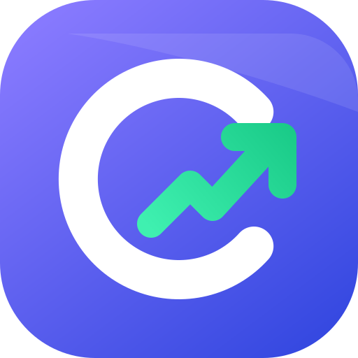

<div align="center">



# Cryptoc

**Live crypto prices, interactive charts, a local portfolio tracker, converter and news, in one fast, responsive app.**

React 19 · Vite 7 · Redux Toolkit (RTK Query) · Chart.js · CoinGecko API

</div>

---

## Table of contents

1. [Overview](#overview)
2. [Features](#features)
3. [Tech stack](#tech-stack)
4. [Getting started](#getting-started)
5. [Environment variables](#environment-variables)
6. [Scripts](#scripts)
7. [Project structure](#project-structure)
8. [Architecture](#architecture)
9. [Data sources](#data-sources)
10. [Performance](#performance)
11. [Theming and design system](#theming-and-design-system)
12. [Keyboard and accessibility](#keyboard-and-accessibility)
13. [Deployment](#deployment)
14. [Troubleshooting](#troubleshooting)
15. [Roadmap](#roadmap)
16. [Branding](#branding)
17. [Disclaimer](#disclaimer)

---

## Overview

Cryptoc is a single-page application for following the crypto market. It reads public market data from CoinGecko, presents it in a dark-first trading-app interface (with a light theme), and keeps your personal data (watchlist, holdings, preferences) on your own device. No account and no backend are required.

## Features

### Market intelligence
| Area | What you get |
| --- | --- |
| **Overview** | Global market cap with 24h change, 24h volume, active coins and markets, BTC/ETH dominance bar, **Fear & Greed gauge**, trending coins, top gainers and losers, watchlist summary, top 10 table, latest news |
| **Markets** | Top 100 coins by market cap with price, 1h / 24h / 7d change, 24h volume, market cap and a **7-day sparkline**. Sort any column, search, filter (All, Watchlist, Gainers, Losers), "show more" paging, auto-refresh every minute |
| **Coin page** | Interactive area chart (24H, 7D, 1M, 3M, 1Y) with crosshair tooltip and period change, **24h range bar**, circulating-supply progress, all-time high / low with dates, market cap, fully diluted value, volume ratio, performance across 1h to 1y, price calculator, description and official links |
| **Exchanges** | Ranked exchanges with trust score bar, 24h volume in BTC and in your chosen currency, founding year, country and a link out |
| **News** | Topic filters (All, Bitcoin, Ethereum, Blockchain, DeFi, NFTs), cards with images, source and relative time, previous / next paging |

### Personal tools
- **Watchlist**: star any coin anywhere in the app. Saved locally.
- **Portfolio**: add holdings with amount and buy price. See total balance, total profit / loss, 24h change, per-asset value and an **allocation donut**. Valued in USD so numbers stay consistent when you switch display currency.
- **Converter**: convert between any top-100 coin and USD, NGN, EUR or GBP at live rates, with a swap button and quick pairs.
- **Currency switcher**: USD, NGN, EUR, GBP across prices, market caps and charts.
- **Theme**: dark and light, remembered between visits.

### Interface and polish
- Sidebar navigation on desktop, bottom tab bar on mobile
- Global search with arrow-key navigation (press `/` to focus)
- Skeleton loading, friendly empty states and retryable error states
- Toast feedback for watchlist and portfolio actions
- Respects `prefers-reduced-motion`

## Tech stack

| Layer | Choice |
| --- | --- |
| UI | React 19, React Router 7 |
| Data fetching and cache | Redux Toolkit + RTK Query |
| Charts | Chart.js 4 via react-chartjs-2 (sparklines and the Fear & Greed gauge are hand-drawn SVG) |
| Icons | lucide-react |
| Typography | Manrope Variable (`@fontsource-variable/manrope`, self-hosted) |
| Styling | Hand-written CSS with design tokens (no UI framework) |
| Build tool | Vite 7 |
| Linting | ESLint 9 with React Hooks and React Refresh plugins |

## Getting started

**Requirements:** Node.js 18 or newer and npm.

```bash
# 1. install dependencies
npm install

# 2. start the dev server (http://localhost:5173)
npm run dev
```

For the fastest experience, run the production build locally:

```bash
npm run build
npm run preview
```

`npm run dev` is intentionally the slower, debug-friendly mode.

## Environment variables

Create a `.env` file in the project root (it is git-ignored for local use):

```env
# Optional. Your newsdata.io API key for the News section.
VITE_NEWS_API_KEY=your_key_here
```

If it is not set, the app falls back to a key embedded in `src/Services/cryptoNewsApi.js`. **Use your own key and avoid committing keys to a public repository.** Anything prefixed with `VITE_` is bundled into the browser build, so treat it as public; use a free-tier key and rotate it if it leaks.

CoinGecko's public endpoints used here need no key.

## Scripts

| Command | Purpose |
| --- | --- |
| `npm run dev` | Start the Vite dev server with hot reload |
| `npm run build` | Create an optimized production build in `dist/` |
| `npm run preview` | Serve the production build locally |
| `npm run lint` | Run ESLint across the project |

## Project structure

```
.
├── index.html                 # entry HTML, instant splash screen, theme bootstrap
├── vercel.json                # SPA rewrite for Vercel
├── public/
│   ├── logo.svg · logo.png    # app icon (vector and 512px)
│   ├── logo-lockup-*.png      # icon + wordmark for dark / light backgrounds
│   ├── favicon.svg
│   └── _redirects             # SPA fallback for Netlify
└── src/
    ├── main.jsx               # providers + root error boundary
    ├── App.jsx                # layout, lazy routes, idle prefetch
    ├── App/store.js           # Redux store
    ├── Services/
    │   ├── coinGeckoApi.js    # RTK Query endpoints (markets, global, trending, details, history, FX, exchanges, Fear & Greed)
    │   └── cryptoNewsApi.js   # newsdata.io endpoint
    ├── context/AppContext.jsx # theme, currency, watchlist, holdings, toast (persisted)
    ├── hooks/useMarkets.js    # shared markets query + on-device cache
    ├── utils/format.js        # currency, compact number, percent and time formatters
    ├── chartconfig.js         # Chart.js registration (loaded only with chart screens)
    ├── styles/index.css       # tokens, themes, components, responsive rules
    └── Components/
        ├── Navbar.jsx · navItems.js · Topbar.jsx
        ├── Homepage.jsx       # Overview
        ├── Cryptocurrencies.jsx   # Markets table (also reused on Overview)
        ├── CryptoDetails.jsx · PriceChart.jsx
        ├── Portfolio.jsx · AddAssetModal.jsx
        ├── Converter.jsx · Exchange.jsx · News.jsx
        ├── FearGreed.jsx · Logo.jsx
        ├── ErrorBoundary.jsx
        └── ui.jsx             # Sparkline, Change pill, CoinLabel, Skeleton, states
```

## Architecture

```
          ┌──────────────┐        ┌───────────────────────┐
 UI  ───▶ │ RTK Query    │ ─────▶ │ CoinGecko / newsdata  │
 hooks    │ cache + poll │ ◀───── │ alternative.me        │
          └──────┬───────┘        └───────────────────────┘
                 │ same args = one request
          ┌──────▼───────┐        ┌───────────────────────┐
          │ useMarkets   │ ─────▶ │ localStorage snapshot │ ─▶ instant first paint next visit
          └──────────────┘        └───────────────────────┘
          ┌──────────────┐
          │ AppContext   │ ─────▶ localStorage (theme, currency, watchlist, holdings)
          └──────────────┘
```

Key decisions:

- **One markets request feeds many screens.** The top 100 coins (with sparklines and 1h / 24h / 7d change) are requested once with identical arguments, so the Overview, Markets table, global search, converter and portfolio all share one cached response instead of five requests. This keeps the app well inside CoinGecko's free rate limits.
- **Stale-while-revalidate on disk.** The last good market response is stored (sparklines trimmed to about 42 points). On the next visit the table renders immediately and fresh prices replace it as they arrive.
- **Routes are code-split.** Heavy screens (chart, portfolio, converter, exchanges) load on demand and are prefetched when the browser is idle.
- **Failure is contained.** A root error boundary and a per-route boundary keep the sidebar alive if one screen fails, show the error message and offer a "clear saved data" reset.
- **Money formatting is centralized** in `utils/format.js`, with extra precision for sub-cent prices (SHIB, PEPE and similar).

### Local storage keys

| Key | Content |
| --- | --- |
| `cryptoc:theme` | `"dark"` or `"light"` |
| `cryptoc:currency` | `usd`, `ngn`, `eur` or `gbp` |
| `cryptoc:watchlist` | Array of CoinGecko coin ids |
| `cryptoc:holdings` | Portfolio lots (coin, amount, buy price in USD) |
| `cryptoc:markets:<currency>` | Cached market snapshot for instant paint |

Clearing site data resets all of it. Nothing is sent to any server.

## Data sources

| Source | Used for | Key needed |
| --- | --- | --- |
| [CoinGecko API v3](https://www.coingecko.com/en/api) | Markets, global stats, trending, coin details, price history, exchanges, FX rates | No (public tier) |
| [alternative.me](https://alternative.me/crypto/fear-and-greed-index/) | Crypto Fear & Greed index | No |
| [newsdata.io](https://newsdata.io/) | News | Yes (`VITE_NEWS_API_KEY`) |

Endpoints in use: `/coins/markets`, `/global`, `/search/trending`, `/coins/{id}`, `/coins/{id}/market_chart`, `/simple/price`, `/exchanges`.

Notes:
- CoinGecko's free tier is rate-limited and chart history is limited to one year, which is why the longest range is **1Y**.
- Fiat conversion rates for NGN, EUR and GBP are derived from Bitcoin's price in each currency, so they are market-implied rates, not official bank rates.

## Performance

- Main bundle around 110 KB gzipped, with chart code split into separate chunks
- Memoized table rows and sparklines, so a price refresh does not repaint the whole table
- Polling pauses while the tab is in the background
- No `backdrop-filter` blur on large sticky surfaces, which keeps scrolling smooth on modest hardware
- Redux dev-only serialization and immutability checks are disabled, since market payloads are large and plain JSON
- Instant HTML splash so the page is never blank while JavaScript loads
- Fonts are self-hosted and swap in without blocking text

## Theming and design system

All colors, surfaces and accents are CSS custom properties defined at the top of `src/styles/index.css`, with a dark set (default) and a light set selected through `data-theme` on `<html>`.

| Token | Role |
| --- | --- |
| `--bg`, `--surface`, `--surface-2`, `--surface-3` | Page and card layers |
| `--text`, `--text-2`, `--text-3` | Primary, secondary, muted text |
| `--accent` | Brand indigo for actions and active states |
| `--up`, `--down` | Gains and losses (green / red) |
| `--line`, `--line-strong` | Borders and dividers |

To rebrand, change `--accent` and the gradient stops in `src/Components/Logo.jsx`.

## Keyboard and accessibility

| Key | Action |
| --- | --- |
| `/` | Focus global search |
| `↑` `↓` `Enter` | Move through and open search results |
| `Esc` | Close search or a dialog |
| `Enter` on a table row | Open that coin |

Interactive controls have visible focus rings and ARIA labels, tabs and sort headers expose their state, and motion is reduced for users who prefer it.

## Deployment

The app is a static site, so any static host works. Because it uses client-side routing, the host must serve `index.html` for unknown paths. Both configs are already included.

**Vercel:** import the repository. Build command `npm run build`, output directory `dist`. `vercel.json` handles route rewrites.

**Netlify:** build command `npm run build`, publish directory `dist`. `public/_redirects` handles route fallback.

Set `VITE_NEWS_API_KEY` in the host's environment settings before building.

## Troubleshooting

| Symptom | Fix |
| --- | --- |
| "Couldn't load data" or empty tables | CoinGecko is rate-limiting. Wait about a minute and use **Try again**. Cached prices still show if you have visited before |
| News section shows an error | The newsdata.io free plan limits calls. Try again later or use your own key |
| Dev server shows stale code after editing | Stop it and run `npx vite --force`, then hard refresh with `Ctrl + Shift + R` |
| "This screen hit a problem" | Read the message shown, then try **Clear saved data and reload**. Report the message if it persists |
| Error `destroy is not a function` | An effect returned a value. Effects must use a block body, for example `useEffect(() => { window.scrollTo(0, 0); }, [path])`, never `useEffect(() => window.scrollTo(0, 0), [path])` |
| Portfolio shows `*` next to a price | The coin is outside the top 100, so its live price is unavailable and your buy price is shown instead |
| App feels slow in dev | Use `npm run build && npm run preview` for real-world speed |

## Roadmap

Ideas that fit the current architecture:

- [ ] Price alerts with browser notifications
- [ ] Candlestick (OHLC) charts and volume bars
- [ ] Portfolio history chart and CSV import / export
- [ ] Optional cloud sync of watchlist and portfolio
- [ ] More fiat currencies and a coin search beyond the top 100
- [ ] Installable PWA with offline snapshot
- [ ] Unit tests for formatters and portfolio math

## Branding

The mark is a coin-shaped **C** whose open side becomes a rising price line. Assets live in `public/`:

| File | Use |
| --- | --- |
| `logo.svg` | Master vector icon, app icon and loading splash |
| `logo.png` | 512 px raster icon |
| `favicon.svg` | Browser tab icon |
| `logo-lockup-dark.png` / `logo-lockup-light.png` | Icon with wordmark for dark and light backgrounds |

## Disclaimer

Cryptoc is for information only and is not financial advice. Prices and rankings come from third-party APIs and may be delayed or inaccurate. Cryptocurrency is volatile, so do your own research before making decisions. Portfolio values are estimates based on the buy prices you enter.